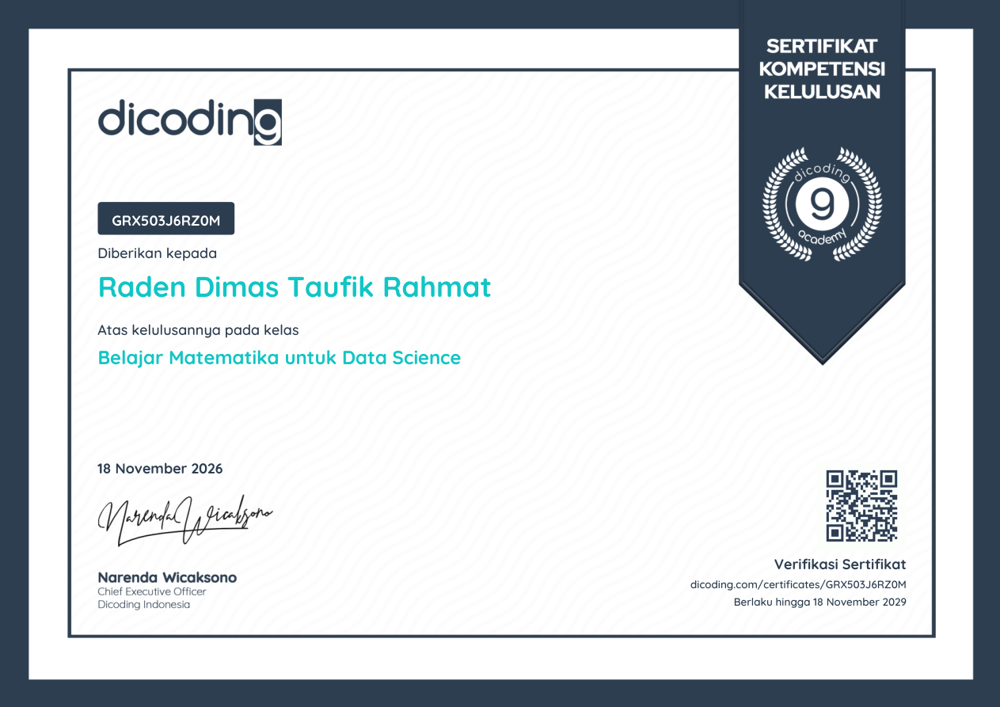
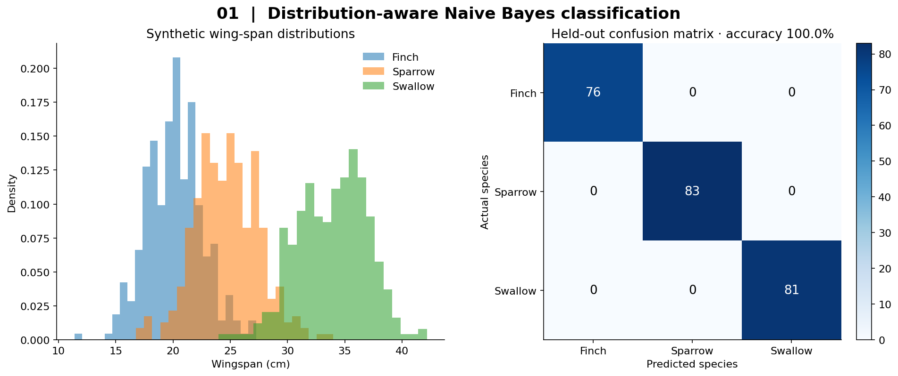
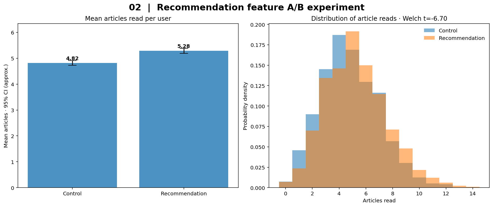
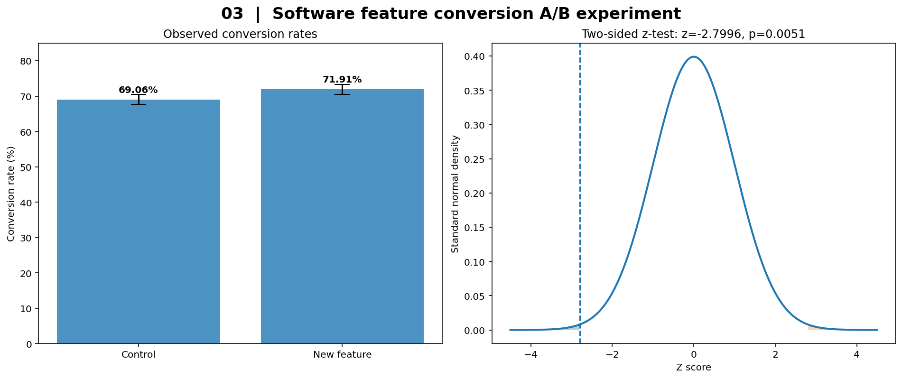

# Portofolio Matematika untuk Data Science

Proyek ini adalah **rekreasi portofolio mandiri** dari konsep yang saya pelajari dalam kelas [Belajar Matematika untuk Data Science](https://www.dicoding.com/academies/831) pada program **Asah 2026 — Data Science Specialist**.

**Penulis:** Raden Dimas Taufik Rahmat / [RadenAlta](https://github.com/RadenAlta).

## Pencapaian resmi

- Submission Akhir Dicoding: **Advanced (4,0/4,0) — Bintang 5**.
- Kriteria implementasi dan Knowledge Check: keduanya **Advanced**.
- Knowledge Check: **15/15 jawaban benar**.
- Submission ID: **5135103**, dikumpulkan 18 November 2026.
- **Sertifikat kelulusan resmi:** [GRX503J6RZ0M — verifikasi Dicoding](https://www.dicoding.com/certificates/GRX503J6RZ0M).
- **Diberikan kepada:** Raden Dimas Taufik Rahmat; **terbit:** 18 November 2026; **berlaku hingga:** 18 November 2029.
- **Tingkat kelas:** Menengah; **beban belajar kurikulum:** 70 jam (bukan klaim waktu belajar pribadi).

**Pemisahan bukti:** sertifikat membuktikan kelulusan kelas, sedangkan **Advanced 4,0/4,0** dan **15/15 Knowledge Check** adalah hasil review submission resmi.

## Sertifikat yang dapat diverifikasi

[Verifikasi sertifikat resmi di Dicoding](https://www.dicoding.com/certificates/GRX503J6RZ0M) · [Detail kredensial](certificates/README.md)

## Studi kasus portofolio

1. **Klasifikasi jenis burung** — dataset sintetis, Gaussian/Uniform/Binomial, Naive Bayes menggunakan penjumlahan *log-probability*.
2. **Eksperimen sistem rekomendasi** — perbandingan jumlah artikel yang dibaca menggunakan **Welch's t-test**.
3. **Eksperimen konversi fitur perangkat lunak** — pengujian dua proporsi dengan **Z-test**.

**Catatan penting:** Angka-angka studi kasus merupakan contoh berbasis data sintetis, bukan hasil eksperimen bisnis sungguhan. Source code di repo ini ditulis ulang sebagai portofolio, bukan file submission yang dinilai atau kunci jawaban Dicoding. Notebook di folder `notebooks/` sudah dieksekusi dan menyertakan output; skrip bisa dijalankan ulang.

Untuk instruksi lengkap, lihat [README utama (English)](README.md) serta [laporan proyek](reports/PROJECT_REPORT.md).
