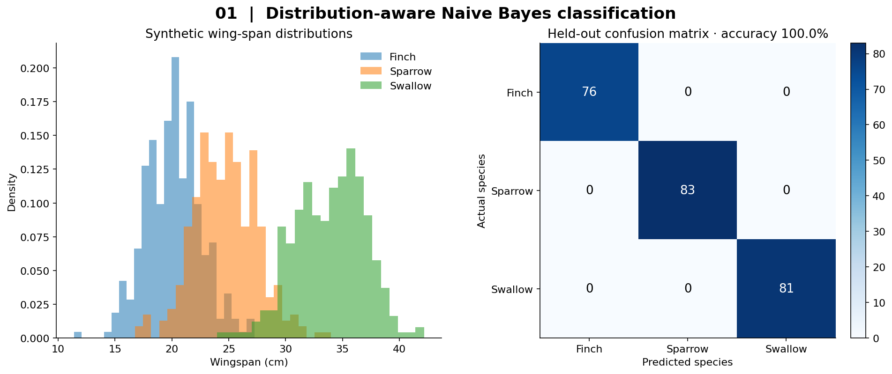
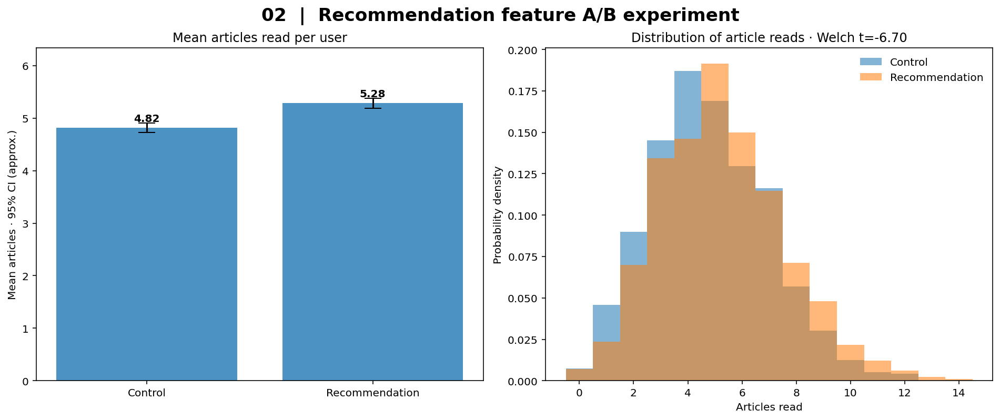
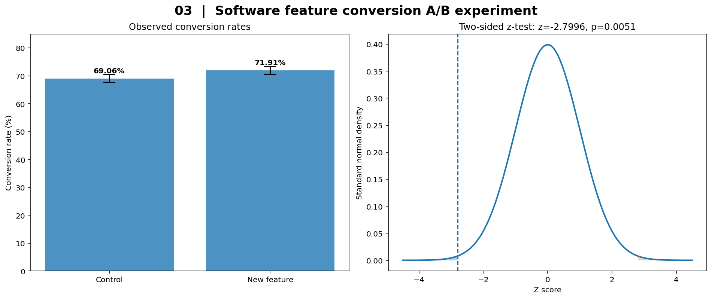
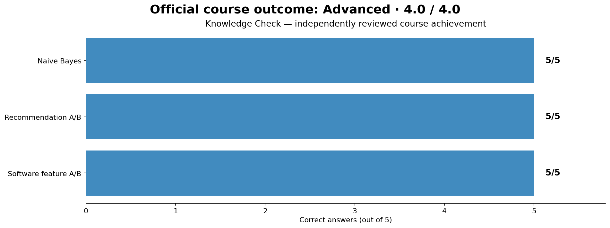

# Mathematics for Data Science — Applied Statistical Learning Lab

**Naive Bayes · Probability distributions · Hypothesis testing · A/B experiments**

[](https://www.python.org/)
[](https://www.dicoding.com/academies/831)


A reproducible **three-case-study portfolio** demonstrating how probability distributions, classification and frequentist hypothesis tests can support data science decisions. Created by **Raden Dimas Taufik Rahmat** (GitHub: [@RadenAlta](https://github.com/RadenAlta)) following the Dicoding **Belajar Matematika untuk Data Science** course as part of the **Asah 2026 — Data Science Specialist** learning programme.

> **Academic integrity:** This is an **independent, original portfolio reimplementation**, not an upload of the graded Dicoding notebook templates, question bank, or answer key. It uses synthetic data, openly explains the methodology and reports limitations. Original assessment files are deliberately not published.

## Project at a glance

| Case study | Question | Method | Reproduced portfolio result |
|---|---|---|---|
| **01 — Bird species** | Can different feature distributions identify simulated bird species? | Naive Bayes with Gaussian, Uniform and Binomial likelihoods; log-probabilities | **100.0%** hold-out accuracy on intentionally separable synthetic data |
| **02 — Recommendations** | Does a simulated recommendation feature increase articles read? | Independent groups, Welch's two-sided t-test | **4.817 → 5.283** mean articles; **t = −6.70**, p ≈ **2.30 × 10⁻¹¹** |
| **03 — Software conversion** | Is the baseline conversion rate different from a feature variant? | Pooled two-proportion z-test | **69.06% → 71.91%**, **z = −2.7996**, **p = 0.00512** |

*Results above were generated by running the **portfolio demonstration**, which is distinct from the graded Dicoding submission. They are illustrative, not measurements of a deployed product.*

## Visual results and notebook screenshots

### 01 — Naive Bayes: feature distributions and classification



[Open the full notebook](notebooks/01-bird-species-naive-bayes.ipynb) · [Preview the executed notebook output](assets/screenshots/01-notebook-output.png)

### 02 — Recommendation A/B experiment



[Open the full notebook](notebooks/02-recommendation-ab-testing.ipynb) · [Preview the executed notebook output](assets/screenshots/02-notebook-output.png)

### 03 — Conversion A/B experiment



[Open the full notebook](notebooks/03-conversion-ab-testing.ipynb) · [Preview the executed notebook output](assets/screenshots/03-notebook-output.png)

## Verified Dicoding course achievement

In the **official submitted assignment** (separate from this public reimplementation), Dicoding's reviewer accepted both assessment criteria at **Advanced** level:

| Official assessment | Reviewer result |
|---|---|
| Algorithm implementation and hypothesis testing | **Advanced** |
| Knowledge Check | **Advanced** |
| Knowledge Check — three topics | **5/5 + 5/5 + 5/5 = 15/15** |
| **Final mastery score** | **4.0 / 4.0 — Advanced (5 stars)** |

- Reviewed submission: **18 November 2026**; Submission ID **5135103**.
- Course: [Belajar Matematika untuk Data Science (Dicoding Academy 831)](https://www.dicoding.com/academies/831).
- Certificate link shared for the completed course: [Dicoding certificate page](https://www.dicoding.com/academies/831/certificates/3913658).



The achievement graphic is a **summary of reported reviewer feedback**, **not** a screenshot of Dicoding's private review interface.

## How to reproduce

Requirements: Python 3.11+ and the packages in `requirements.txt`.

```bash
python -m venv .venv
# Windows PowerShell: .\.venv\Scripts\Activate.ps1
# Linux/macOS: source .venv/bin/activate
pip install -r requirements.txt

python -m unittest discover -s tests -v
python -m src.bird_naive_bayes
python -m src.recommendation_ab
python -m src.conversion_ab
python -m src.visualize

jupyter lab
```

Open the notebooks under [`notebooks/`](notebooks/) to explore inputs, methodology, results, figures and limitations. The committed `.ipynb` files already contain executed outputs for quick review. Run the scripts from the **repository root**.

## Repository structure

```text
.
├── README.md                     # English project overview and figures
├── README.id.md                  # Ringkasan Bahasa Indonesia
├── index.html                    # Optional static GitHub Pages portfolio
├── notebooks/                    # Three original, executed demonstration notebooks
├── src/                          # Reusable, reproducible statistical implementations
├── tests/                        # Automated sanity and reproducibility checks
├── assets/
│   ├── figures/                  # Charts generated by Python
│   └── screenshots/              # Previews using actual executed notebook outputs
├── reports/                      # Methods, results, limitations, and portfolio copy
├── scripts/                      # Notebook regeneration and PowerShell publishing guide
├── requirements.txt
└── .github/workflows/tests.yml   # GitHub Actions CI
```

## Statistical methodology in brief

**Naive Bayes:** estimates class priors and class-conditional feature distributions, then sums log-likelihoods to predict the most probable species. This avoids underflow from multiplying many very small probabilities.

**Welch t-test:** estimates each group's mean and variance, computes a standard error without equal-variance assumptions, and uses Welch–Satterthwaite degrees of freedom to obtain a two-sided p-value.

**Two-proportion z-test:** compares binary event rates using the pooled null proportion and a two-sided normal tail probability. The sign of the z-score depends on the chosen subtraction order, and significance does not automatically imply product success.

## Limitations and next steps

All observations are **synthetic**. Artificially separated bird classes can yield 100% hold-out accuracy, which must not be presented as real-world performance. Statistical significance does not establish practical importance, generalisability, or causal validity without strong experimental design. A production version should include real data provenance, effect-size uncertainty, power analysis, and guardrail/stop rules.

Review feedback also highlighted useful next steps: log-probability stability, avoiding optional stopping/peeking during A/B tests, and selecting Welch's t-test where group variances differ. See [`reports/PROJECT_REPORT.md`](reports/PROJECT_REPORT.md).

## Attribution and responsible sharing

- Original learning programme and course: © their respective owners, including Dicoding Indonesia.
- This portfolio showcases a separately written implementation and **does not** redistribute restricted course question sheets, graded notebook solutions, or answer-key spreadsheets.
- No licence has been granted to reuse this repository as a graded assignment; please do not copy code into course submissions.

**Author:** Raden Dimas Taufik Rahmat · [GitHub](https://github.com/RadenAlta) · [Dicoding](https://www.dicoding.com/users/radendimas_tr)
