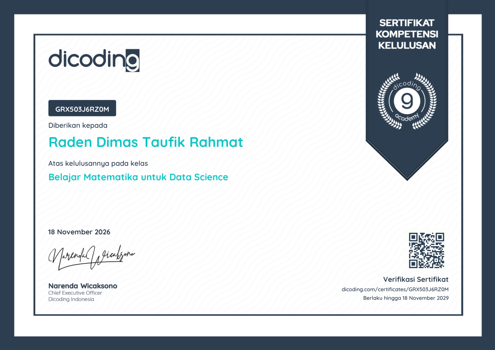

# Official Dicoding completion certificate

| Item | Verified detail |
|---|---|
| Learner | Raden Dimas Taufik Rahmat |
| Issuer | Dicoding Indonesia |
| Course | Belajar Matematika untuk Data Science (Academy 831) |
| Level | Intermediate (Menengah) |
| Published curriculum workload | 70 hours (not measured individual study time) |
| Certificate ID | `GRX503J6RZ0M` |
| Issued | 18 November 2026 |
| Valid through | 18 November 2029 |
| Official verification | [Verify on Dicoding](https://www.dicoding.com/certificates/GRX503J6RZ0M) |

**Separate graded assessment:** The submission reviewer awarded Advanced (4.0/4.0) and 15/15 correct Knowledge Check answers (Submission ID 5135103). These scores originate from the official review, not the certificate text.

**Sharing policy:** This repository shares independent synthetic-data case studies, not graded notebooks, course questions, or answer sheets. The preview above is reproduced from the certificate supplied by its holder; verify authenticity using the official Dicoding link.
